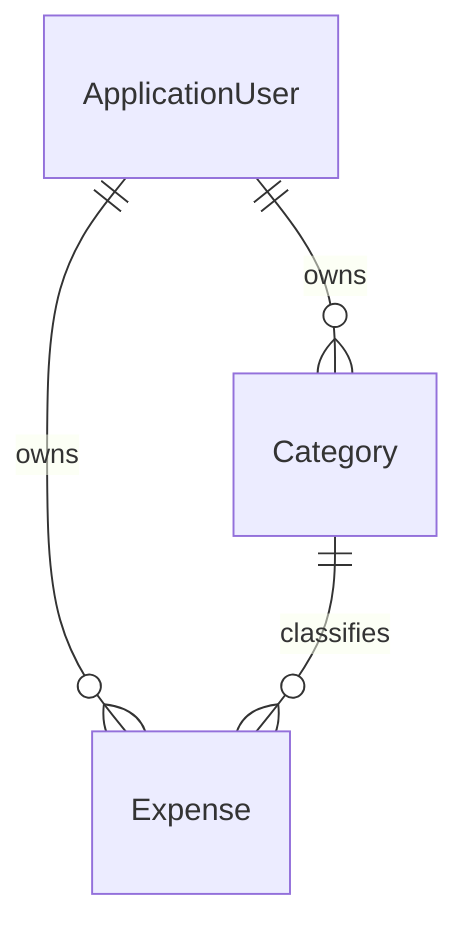

# Expense and Category data model

Implemented 31 October 2026 for task 2. This milestone adds storage and integrity rules; it does not add expense forms, category seeding or owner-scoped application services.

## Relationships

Each expense has one owner and one category. The category must belong to the same owner. The composite foreign key `(CategoryId, UserId)` references the category alternate key `(Id, UserId)`. This enforces ownership consistency even if a future service accidentally submits a mismatched category.

This relationship does not authorise reads. Task 3 must filter every read and mutation by the authenticated user's ID, obtained on the server.

## Why these types

- `AmountCents` is `long`: A$24.50 is stored as 2450, with a database range of 1 through 99,999,999 cents. Forms will use decimal and validate precision before converting; conversion is not implemented in this milestone.
- `ExpenseDate` is `DateOnly`: a purchase day is not an instant and should not move when the display time zone changes.
- Audit fields are `DateTime`: the future service will explicitly assign UTC creation/update values. Mapping a required timestamp does not itself generate or validate UTC values.
- Merchant and notes are nullable: they are not necessary to record an expense.
- `IsArchived` keeps old category relationships intact. Rules preventing new assignments to archived categories belong in the next application-service work.

## Names and duplication

Setting `Category.Name` trims whitespace and updates the invariant-uppercase `NormalizedName`, including on rename. A unique index on `(UserId, NormalizedName)` prevents duplicate names for the same owner, including archived categories. Different users can both have Groceries.

Normalisation is applied by the C# entity; the database's unique index enforces uniqueness of the stored key. Raw SQL callers must preserve that normalisation invariant. SQLite checks also reject empty or oversized category names. Merchant and notes limits are checked in SQLite because HasMaxLength alone does not enforce SQLite text lengths.

## Deletion behaviour

Deleting a category referenced by an expense is restricted. Deleting a user with categories or expenses is also restricted. The eventual account-deletion workflow must explicitly handle dependent data; the generated Identity deletion screen is not a complete account-deletion implementation for this model.

Archiving changes a flag and preserves expense history. No hard-delete or archive UI is added here.

## Separation of responsibilities

- Models describe the stored records and category name invariant.
- Configuration classes describe keys, indexes, relationships and SQLite constraints.
- ApplicationDbContext preserves Identity mappings before applying these configurations.
- The migration creates Categories and Expenses without altering Identity tables.
- Services and forms will enforce the supported date range, Sydney 'today', text trimming, money precision, archived assignment rules and user access. Those are not claimed complete here.

## Verification

The suite has 22 passing cases, using real SQLite with migrations and foreign keys enabled. Coverage includes exact amount boundaries, invalid amounts, purchase-date round trips, cross-owner inserts/updates, missing categories, duplicate/renamed/archived category names, shared names across different owners, archive history, restrictive deletes and stored text-length limits.

The existing Identity test now starts with the original schema, inserts an account and then upgrades. Fresh database creation is exercised by each new model test.

A consistent SQLite backup was created before local migration. A separate copy was migrated first and all existing Identity rows were compared before/after. The local migration was then checked the same way. Backup files remain ignored and are not published.

## Reading the code together

1. Start with Expense.cs and Category.cs to understand the records.
2. Read the two configuration classes to distinguish a field from a database guarantee.
3. Follow the two-part category relationship and explain why CategoryId alone is insufficient.
4. Read the migration's Up method: it adds tables and indexes, preserving existing accounts.
5. Read AnotherOwnersCategory_IsRejected and ReferencedCategory_CannotBeDeleted to see database guarantees exercised.

## References

- [EF Core foreign and principal keys](https://learn.microsoft.com/en-us/ef/core/modeling/relationships/foreign-and-principal-keys)
- [EF Core indexes](https://learn.microsoft.com/en-us/ef/core/modeling/indexes)
